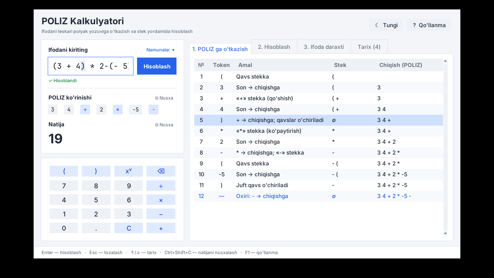
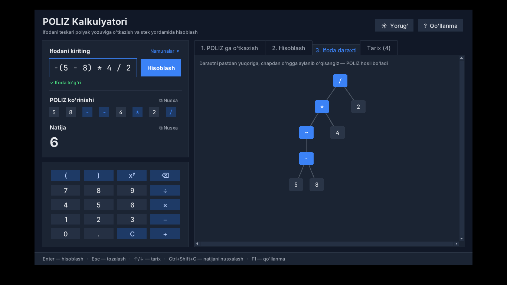

# POLIZ Kalkulyatori

Infiks ifodani **POLIZ** (Polşa invers yozuvi, RPN) körinişiga ötkazadigan va stek yordamida
hisoblaydigan öquv kalkulyatori. Har bir qadamni körsatadi. Interfeys macOSning
**Liquid Glass** uslubida, matnlar 2026-yil oktabrda qabul qilingan yangi özbek lotin
alifbosida (ö, ğ, ş, ç).




## Işga tuşiriş

Python 3.9 yoki undan yangi versiyasi kerak.

```bash
pip install pywebview
```

```bash
python3 poliz_kalkulyator.py
```

- **pywebview örnatilgan bölsa** — alohida oyna oçiladi. macOSda oyna orqasidagi iş stoli
  xiralaşib körinadi (haqiqiy vibrancy, NSVisualEffectView).
- **pywebview bölmasa** — dastur standart brauzerda oçiladi. Bu holda şişa effekti rangli fon
  ustida CSS `backdrop-filter` bilan çiziladi. Brauzerda majburan oçiş uçun: `--browser`.

Testlar:

```bash
python3 -m unittest -v
```

## macOS ilovasi (.app)

Python örnatmasdan, Launchpad yoki Dockdan oçiladigan `POLIZ Kalkulyatori.app`.

**1-yöl: tayyorini yuklab oliş.** GitHub Actions har bir push'da ilovani Mac serverida
yiğadi. Uni şunday yuklab olasiz:

1. Repodagi **Actions** bölimiga kiring.
2. **macOS ilovasi** iş oqimining eng söngi yaşil yiğişini oçing.
3. **Artifacts** böliminden `POLIZ-Kalkulyatori-macOS` ni yuklab oling.
4. Arxivni oçing va `POLIZ Kalkulyatori.app` ni **Applications** papkasiga sudrab taşlang.

Ilova Apple tomonidan imzolanmagani uçun macOS uni birinçi marta oçişga ruxsat bermaydi.
Ruxsat beriş uçun **System Settings → Privacy & Security** bölimining pastida
**Open Anyway** ni bosing. Yoki Terminalda bir marta quyidagini işga tuşiring:

```bash
xattr -dr com.apple.quarantine "/Applications/POLIZ Kalkulyatori.app"
```

**2-yöl: Macda özingiz yiğiş.** Bunda ogohlantiriş umuman çiqmaydi:

```bash
./build_mac.sh
```

Natija `dist/POLIZ Kalkulyatori.app` papkasida paydo böladi.

## Imkoniyatlar

- **Özgaruvçili ifodalar**, PDFdagi kabi: `(A+B)*(C-D)/E` → `A B + C D - * E /`.
  Hisoblaş harflarda körsatiladi: `A B + → A+B`, `C D - → C-D`, … Özgaruvçilarga qiymat
  bersangiz, son natija ham çiqadi.
- **Qiymat beriş**: `x = (a + b) * c;` → `x a b + c * =`.
- **Jonli natija.** Natija yoziş davomida çiqadi. Xato haqidagi xabar esa faqat Enter
  bosilganda körsatiladi: xato belgisi ifodada qizil rang bilan ajratiladi va «3-belgi»
  kabi örni aytiladi.
- **Uç bölim**:
  1. POLIZga ötkaziş (Deykstraning «saralaş stansiyasi»: token, amal, stek, çiqiş);
  2. stekda hisoblaş, sonlarda yoki harflarda;
  3. ifoda daraxti.

  Jadvaldagi qatorni tanlasangiz, mos belgi ifodada ajratib körsatiladi.
- **Tarix.** Hisoblangan ifodalar `~/.poliz_tarix.json` fayliga saqlanadi va
  özgaruvçilar qiymati bilan birga qayta yuklanadi.
- **Qöşimça qulayliklar:** ekran klaviaturasi, PDFdagi namunalar menyusi, PDF asosidagi
  içki qöllanma, mavzu tanlaş (Avto, Yoruğ, Tungi), POLIZ va natijani nusxalaş.

## Yoziş qoidalari

| Belgi | Amal | Ustuvorlik |
|---|---|---|
| `^` (yoki `**`) | darajaga kötariş, öngdan: `2^3^2 = 2^9` | eng yuqori |
| `~` | unar minus: `-(3+4)` → `3 4 + ~` | |
| `*` `/` (yoki `×` `÷`) | köpaytiriş, böliş | |
| `+` `-` | qöşiş, ayiriş | |
| `=` | qiymat beriş, faqat boşida: `x = …` | eng past |

- **Kasr sonlar** `3.5` yoki `3,5` deb yoziladi.
- **Qavs** sifatida `( )`, `[ ]` va `{ }` işlatiladi; oxiridagi `;` eʼtiborga olinmaydi.
- **Songa töğridan-töğri qöyilgan minus** manfiy son böladi:
  `(3 + 4) * 2-(- 5)` → `3 4 + 2 * -5 -` → **19**.
- **Daraja unar minusdan oldin bajariladi:** `-2^2 = -4`.

## Klaviatura

| Tugma | Vazifasi |
|---|---|
| Enter | hisoblaş (özgaruvçi maydonida — keyingi maydonga ötiş) |
| Esc | tozalaş |
| ↑ / ↓ | tarixdagi ifodalar |
| ⌘⇧C (Ctrl+Shift+C) | natijani nusxalaş |
| ⌘1–4 (Ctrl+1–4) | bölimlar |
| F1 yoki ⌘/ | qöllanma |

## Tuzilişi

| Fayl | Vazifasi |
|---|---|
| `poliz_kalkulyator.py` | işga tuşiriş fayli |
| `poliz.py` | mantiq: tokenlar, Shunting-yard, sonli va harfli hisoblaş, daraxt (interfeysga bogʼliq emas) |
| `gui.py` | lokal server (`/api/...`) va pywebview oynasi |
| `build_mac.sh`, `assets/icon.png` | macOS ilovasini yiğiş va uning ikonkasi |
| `.github/workflows/build-mac.yml` | ilovani GitHubning Mac serverida avtomatik yiğiş |
| `ui/` | interfeys: `index.html`, `style.css`, `app.js` |
| `test_poliz.py` | testlar, jumladan PDFdagi barça misollar |
